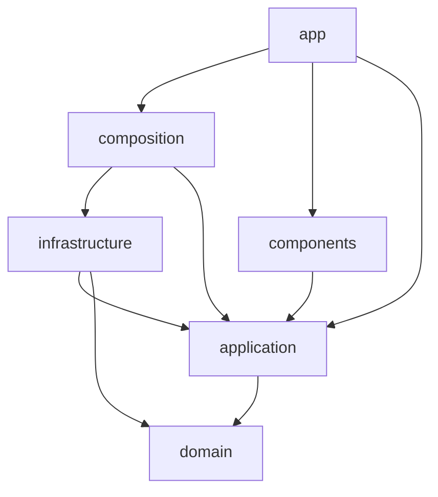

# オニオンアーキテクチャ

ビジネスルールを中心に置き、フレームワーク、DB、認証サービスを外側に置く。外部サービスや題材を差し替えても、中心のコードが変わらないようにする。

## 層の構成

```text
src/
  domain/          エンティティ、値オブジェクト、ドメインサービス、ドメインエラー
  application/     ユースケース、ポート(リポジトリや認証のインターフェース)、DTO
  infrastructure/  ポートの実装(Drizzle、Clerk など)。外部サービスへの依存はここだけ
  composition/     依存の組み立て(composition root)
  app/             Next.js のルート、Server Component、Server Action
  components/      UI コンポーネント
```

ディレクトリは、最初に必要になったときに作る。

## 依存方向

矢印の向きにだけ import できる。



| 層               | import してよいもの                        | 禁止                                                                               |
| ---------------- | ------------------------------------------ | ---------------------------------------------------------------------------------- |
| `domain`         | `domain` のみ                              | 他の層すべて、Next.js、React、DB、外部 SDK                                         |
| `application`    | `domain`、`application`                    | `infrastructure`、`composition`、`app`、`components`、Next.js、React、DB、外部 SDK |
| `infrastructure` | `domain`、`application`、外部 SDK          | `composition`、`app`、`components`                                                 |
| `composition`    | `application`、`infrastructure`            | `app`、`components`                                                                |
| `components`     | `application` の DTO の型、`components`    | `infrastructure`、`composition`、DB、外部 SDK のサーバー用 API                     |
| `app`            | `application`、`composition`、`components` | `infrastructure` の直接の import                                                   |

```ts
// OK: application が domain に依存する
// src/application/submit-guess.ts
import { scoreForHint } from "@/domain/scoring/score";

// NG: domain が外側に依存する
// src/domain/scoring/score.ts
import { db } from "@/infrastructure/db";

// NG: app が composition を通さずに実装へ依存する
// src/app/actions.ts
import { DrizzleGameRepository } from "@/infrastructure/game-repository";
```

## 各層の規則

### domain

- 純粋な TypeScript で書く
- `process.env`、現在時刻、乱数、ネットワークに直接触れない。時刻などの値は引数かポートで受け取る
- ルール違反はドメインエラーか、標準のエラー(`RangeError` など)で表す

### application

- ユースケースごとに 1 ファイルにする
- 外部とのやり取りは、ここで定義したポートを通す
- 戻り値は、外に出してよい項目だけの DTO にする。エンティティをそのまま返さない

### infrastructure

- ポートを実装する
- DB の行や外部 SDK の型を内側へ漏らさない。この層で domain や DTO の型に変換する
- `process.env` はこの層だけで読む

### composition

- ポートと実装を結び付けて、ユースケースを組み立てる
- ビジネスルールを書かない

### app / components

- Server Action と Route Handler は、入力の検証、認証情報の取得、ユースケースの呼び出しだけを行う薄い層にする
- ゲームのルールや得点計算を書かない

## このゲームでの設計方針

- 問題データとゲームロジックを分離する。題材をオリジナルのモンスターに差し替えても、ゲームロジックが変わらないようにする(#1 のセクション 6)
- 「1 日 1 回」は DB の一意制約(ユーザー + 出題日)で保証する。ユースケースの事前確認だけに頼らない
- 出題日の区切りは JST にする。日付の計算は `domain` に置き、現在時刻は外から渡す
