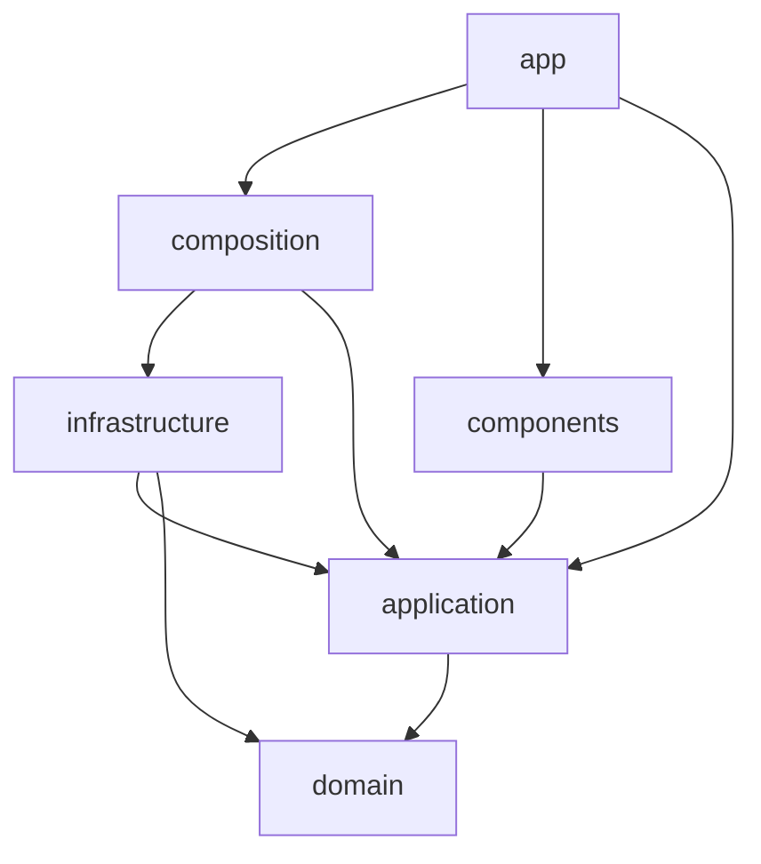

# オニオンアーキテクチャ

ビジネスルールを中心に置き、フレームワークやデータの保存先を外側に置く。外側の実装を変えても、中心のコードが変わらないようにする。

このゲームはサーバーを持たない静的サイトである(#1 のセクション 2)。Next.js の静的書き出しで作り、GitHub Pages で配信して、データはブラウザの IndexedDB に保存する。

## 層の構成

```text
src/
  domain/          エンティティ、値オブジェクト、ドメインサービス、ドメインエラー
  application/     ユースケース、ポート(保存先や現在時刻のインターフェース)、DTO
  infrastructure/  ポートの実装(IndexedDB など)。ブラウザの API への依存はここだけ
  composition/     依存の組み立て(composition root)
  app/             Next.js のルート。静的書き出しで配信する
  components/      UI コンポーネント
```

ディレクトリは、最初に必要になったときに作る。

## 依存方向

矢印の向きにだけ import できる。



| 層               | import してよいもの                        | 禁止                                                                                     |
| ---------------- | ------------------------------------------ | ---------------------------------------------------------------------------------------- |
| `domain`         | `domain` のみ                              | 他の層すべて、Next.js、React、IndexedDB、外部 SDK                                        |
| `application`    | `domain`、`application`                    | `infrastructure`、`composition`、`app`、`components`、Next.js、React、IndexedDB、外部 SDK |
| `infrastructure` | `domain`、`application`、外部 SDK          | `composition`、`app`、`components`                                                       |
| `composition`    | `application`、`infrastructure`            | `domain`、`app`、`components`                                                            |
| `components`     | `application` の DTO の型、`components`    | `domain`、`infrastructure`、`composition`、`app`、IndexedDB の直接の利用                 |
| `app`            | `application`、`composition`、`components` | `domain`、`infrastructure` の直接の import                                               |

`biome.json` の `noRestrictedImports` が、層と Next.js、React の禁止 import を `pnpm lint` のエラーにする。`src/` の各層では親方向の相対 import(`../`)も禁止なので、層をまたぐ import は `@/` で書く。要件は [`docs/specs/coding-standards-enforcement.md`](../../../../docs/specs/coding-standards-enforcement.md) にある。

次の項目は lint で判定できないので、レビューで確認する。

- `components` が `application` の DTO の型だけを import していること
- `domain` と `application` が外部 SDK に依存していないこと
- IndexedDB、`process.env`、現在時刻、乱数を、許されていない層で直接利用していないこと

```ts
// OK: application が domain に依存する
// src/application/submit-guess.ts
import { scoreForHint } from "@/domain/scoring/score";

// NG: domain が外側に依存する
// src/domain/scoring/score.ts
import { openDatabase } from "@/infrastructure/indexed-db";

// NG: app が composition を通さずに実装へ依存する
// src/app/page.tsx
import { IndexedDbGameRepository } from "@/infrastructure/game-repository";
```

## 各層の規則

### domain

- 純粋な TypeScript で書く
- `process.env`、現在時刻、乱数、ネットワークに直接触れない。時刻などの値は引数かポートで受け取る
- ルール違反はドメインエラーか、標準のエラー(`RangeError` など)で表す

### application

- ユースケースごとに 1 ファイルにする
- 外部とのやり取りは、ここで定義したポートを通す
- 戻り値は、UI に必要な項目だけの DTO にする。エンティティをそのまま返さない

### infrastructure

- ポートを実装する
- IndexedDB のレコードや外部 SDK の型を内側へ漏らさない。この層で domain や DTO の型に変換する
- IndexedDB から読んだ値は、内側へ渡す前に検証する

### composition

- ポートと実装を結び付けて、ユースケースを組み立てる
- ビジネスルールを書かない

### app / components

- ゲームのルールや得点計算を書かない
- Node.js のサーバーが必要な機能を使わない。静的書き出しでは、Server Action、リクエストに依存する Route Handler、Cookies、Proxy は動かない(`node_modules/next/dist/docs/01-app/02-guides/static-exports.md`)
- Client Component もビルド時に HTML へ書き出される。IndexedDB を使う処理は、ブラウザで動いているときだけ実行する

## このゲームでの設計方針

- 問題データとゲームロジックを分離する(#1 のセクション 6)
- 「1 日 1 回」は IndexedDB の日付キーで管理し、同じ日の記録を重複させない。データを消せば回避できることは許容する
- 出題日の区切りは JST にする。日付の計算は `domain` に置き、現在時刻は外から渡す
