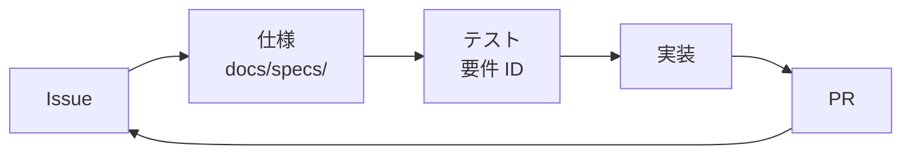

# Issue、Sub Issue、PR

変更の理由を後から追えるようにする。



## Issue

- 新規機能は、検討の時点で、実装の前に必ず Issue を起票する
- テンプレート(機能、バグ、タスク)を使う
- 背景と完了条件を書く
- 脆弱性や正解データの漏えいは、公開の Issue に書かない([`SECURITY.md`](../../../../SECURITY.md))

## Sub Issue

次のいずれかに当てはまる作業は、親 Issue と Sub Issue に分ける。

- 複数の層や領域にまたがる
- 1 つの PR でレビューしきれない

Sub Issue の 1 件が 1 つの PR に対応する大きさを目安にする。

`gh` に専用のフラグがないので、REST API で親に追加する。`sub_issue_id` は Issue 番号ではなく、REST の `id` である。

```sh
id="$(gh api repos/{owner}/{repo}/issues/<子の番号> --jq .id)"
gh api -X POST repos/{owner}/{repo}/issues/<親の番号>/sub_issues -F sub_issue_id="$id"
```

## PR

PR には最低 1 つの Issue を、本文でひも付ける。

| ケース                     | 書き方      |
| -------------------------- | ----------- |
| Issue を解決する           | `Closes #N` |
| Issue の一部だけに対応する | `Refs #N`   |

- 例外は Dependabot の PR のみ
- テンプレートの項目を埋める
- 1 つの PR に、関係のない変更を混ぜない

## ラベル

既存のラベルから選ぶ。存在しないラベルは作らず、必要なら Issue で相談する。

- 種別: `enhancement`、`bug`、`refactor`、`test`、`chore`、`documentation`、`perf`、`ci`、`dependencies`
- 領域: `area:data`、`area:game`、`area:auth`、`area:ui`、`area:db`
- 必要に応じて: `security`、`legal`、`blocked`

## 関連する Skill

`refinement` と `pr-create` の Skill を使える環境では、Issue の整理と PR の作成に併用してよい。

## 名義

コミット、PR、Issue はすべて `eddie-splatoon` 名義にする。詳細は `CLAUDE.md` の「操作アカウント」に従う。
