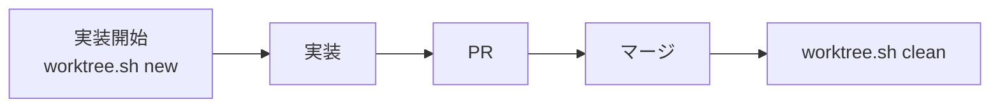

# Git worktree

並列セッションで開発できるように、1 ブランチに 1 つの worktree を割り当てる。セッションごとに作業ディレクトリが分かれるので、変更が衝突しない。



## 規則

- 実装を始めるときに worktree を作る。調査だけの作業には不要
- 親のチェックアウトは `main` のままにする。親で直接開発しない
- PR をマージしたら worktree を削除する
- worktree の作成と削除には `scripts/worktree.sh` を使う。`git worktree remove --force` や `git branch -D` を手で実行しない
- 置き場所は `.claude/worktrees/<ブランチ名の / を - にしたもの>` とする

## 手順

### Claude Code

1. `scripts/worktree.sh new <branch>` を実行する(親のチェックアウトで実行する)
2. 最終行に出力されたパスを、`EnterWorktree` の `path` に渡して入る
3. PR がマージされたら、`ExitWorktree`(`action: "keep"`)で親に戻る
4. 親のチェックアウトで `git pull --ff-only` のあと、`scripts/worktree.sh clean` を実行する

`EnterWorktree` の `name` で作ると、依存がインストールされず、ブランチ名も規約に合わないので使わない。`ExitWorktree` の `remove` も、確認の手順が異なるので使わない。

### 手元のターミナル

```sh
cd "$(scripts/worktree.sh new feat/some-thing | tail -n 1)"
# 実装、PR、マージ
cd "$(git rev-parse --path-format=absolute --git-common-dir)/.."
git pull --ff-only
scripts/worktree.sh clean
```

### 複数の PR を重ねるとき

先の PR のブランチを分岐元にする。

```sh
scripts/worktree.sh new feat/second --base origin/feat/first
```

## `clean` が削除する条件

次のすべてを満たす worktree と、そのローカルブランチだけを削除する。満たさないものは、理由を表示して残す。

- ブランチの PR がマージ済みである
- `HEAD` が PR の head と一致する
- 未コミットの変更と追跡外のファイルがない
- `clean` を実行している worktree 自身ではない

`new` も最初に `clean` を実行する。ブラウザでマージした分は、次の `new` でも回収される。

## 注意

- **マージ**: `gh pr merge` に `--delete-branch` を付けない。リモートのブランチはリポジトリの設定で自動的に削除される。ローカルでは `main` が親で使用中のため、切り替えに失敗することがある
- **削除されるファイル**: `.gitignore` の対象のファイル(`node_modules`、`.env*` など)は、確認なしで一緒に消える。残したいものは worktree の外に置く
- **別のセッションがいる worktree**: マージ済みで変更がなければ、別のセッションが作業中でも削除される。マージ後の worktree で作業を続けない
- **stash**: stash はすべての worktree で共有される。`git stash pop` で別のセッションの変更を取り出さないように、一時的なコミットを使う
- **開発サーバー**: 並列で動かすときは、`pnpm dev --port 3001` のようにポートを分ける
- **名義**: Git のローカル設定は worktree 間で共有されるので、worktree ごとの設定は不要である。`CLAUDE.md` の「操作アカウント」はそのまま適用する
